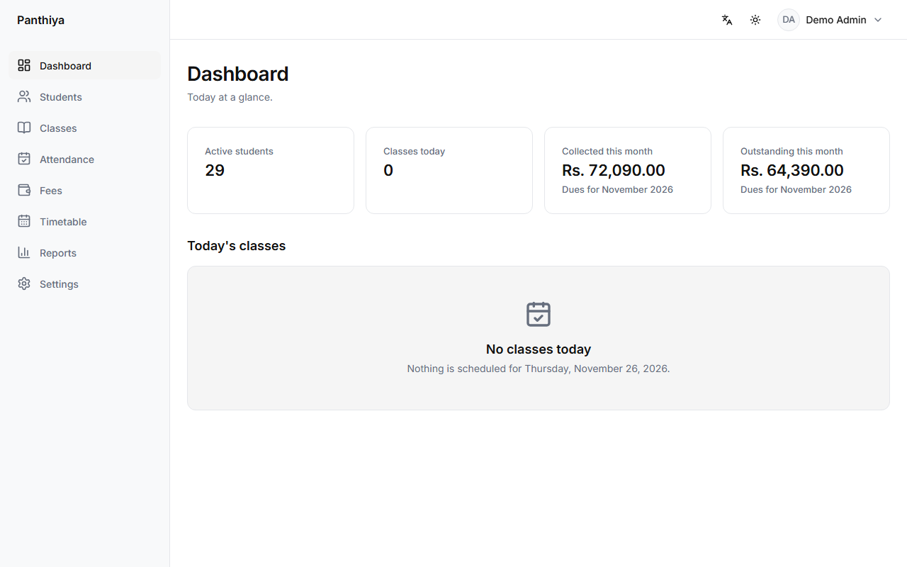
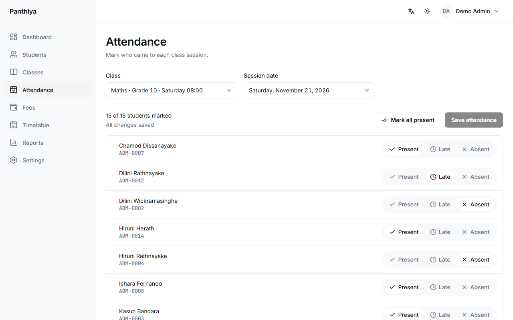
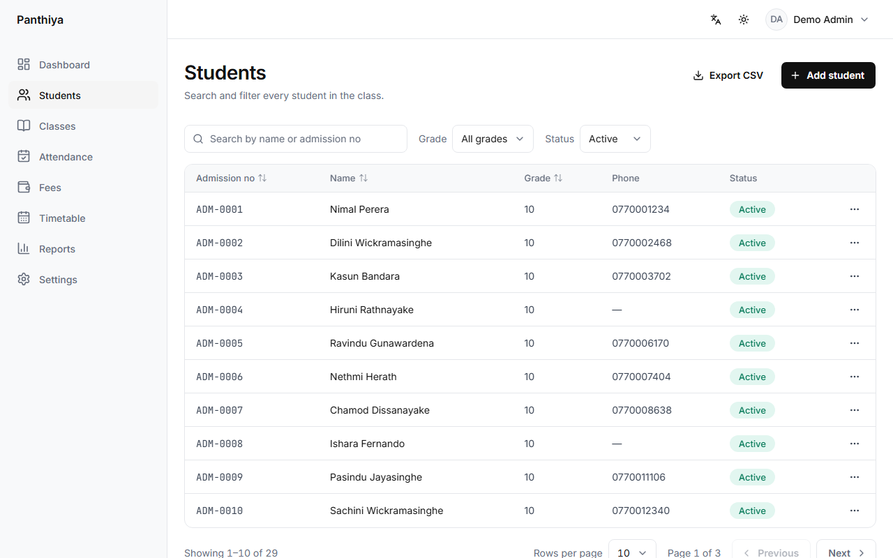
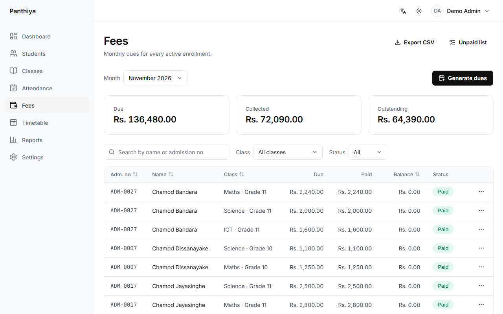
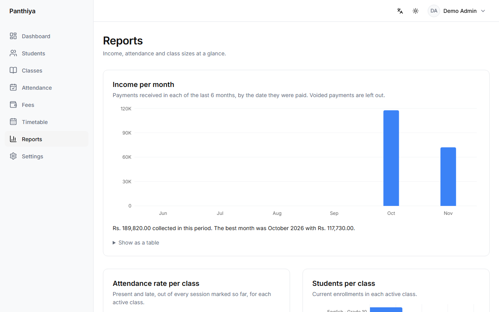
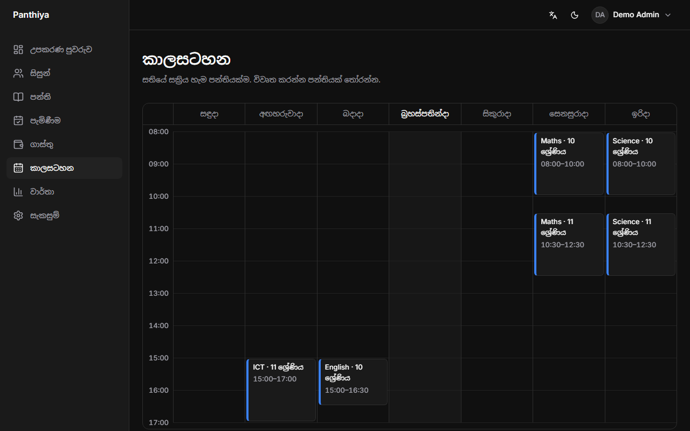
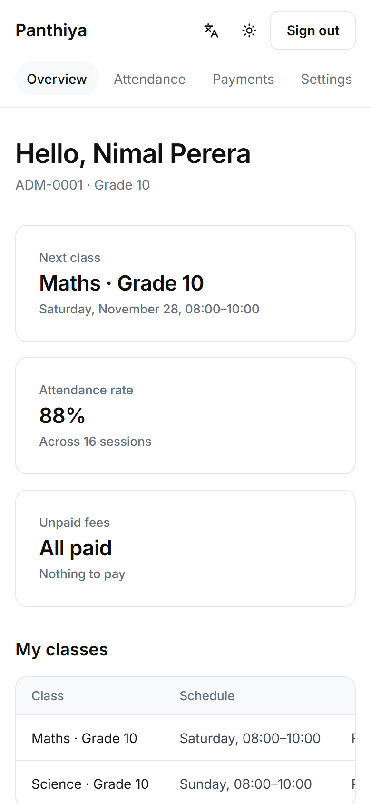

# Panthiya

[](https://github.com/hashan1998-it/Panthiya/actions/workflows/ci.yaml)

Panthiya (පන්තිය, "the class") is a management app for private tuition teachers in Sri Lanka. A teacher keeps students, classes, weekly attendance and monthly fees in one place, with half and free cards, receipts and an unpaid list. Students get their own read-only portal for their classes, attendance and payments. It works in Sinhala and English, in light and dark mode, on a phone or a laptop.

**Live demo:** [panthiya-dev.vercel.app](https://panthiya-dev.vercel.app)

| Role    | Email                 | Password         |
| ------- | --------------------- | ---------------- |
| Admin   | `admin@panthiya.test` | `Demo-Pass-2026` |
| Student | `nimal@panthiya.test` | `Demo-Pass-2026` |

The demo data resets every night at 02:00 Sri Lanka time, so feel free to add, edit and delete.

## Screenshots

| Dashboard                                    | Attendance                                                |
| -------------------------------------------- | --------------------------------------------------------- |
|  |             |
| **Students**                                 | **Fees**                                                  |
|    |                         |
| **Reports**                                  | **Timetable in Sinhala, dark mode**                       |
|      |  |



## Features

- **Students:** search, grade filter, sorting and paging. Add, edit, deactivate, and a profile with tabs for details, classes, attendance and payments.
- **Student logins:** the teacher creates an account for a student from the profile and shares a one-time password.
- **Classes:** subject, grade, weekly day and time, monthly fee. Enroll students in bulk with a discount: none, half card, free card or a custom percentage.
- **Attendance:** pick a class and a session, mark present, late or absent, or mark everyone present. Monthly history per class and per student.
- **Fees:** generate the month's dues in one click, record full or part payments, void a payment, print a receipt, and see who hasn't paid.
- **Dashboard:** active students, today's classes, and this month's collected and outstanding fees.
- **Reports:** income per month, attendance rate per class and students per class, each with a table version.
- **Timetable:** a weekly grid of every class.
- **CSV export:** students, a class's attendance and the fees list.
- **Student portal:** next class, attendance rate, unpaid fees, attendance history and receipts. Students see only their own data.
- **Settings:** change password, language (සිංහල / English) and theme.

## Tech stack

- **App:** Next.js 16 (App Router, Cache Components, Server Actions), React 19, TypeScript
- **UI:** Tailwind CSS 4, Base UI with shadcn-style components, Recharts, TanStack Table, Sonner, next-themes
- **Forms and text:** React Hook Form, Zod 4, next-intl
- **Backend:** Supabase (Postgres, Auth, Row Level Security)
- **Tests:** Vitest and Testing Library, Playwright with axe-core
- **Hosting and CI:** Vercel, GitHub Actions

## Architecture notes

- **Security lives in the database.** Every table has Row Level Security. Admin rights go through a `security definer` function, `is_admin()`. A student's queries return only their own rows, and their inserts, updates and deletes are refused, so hiding a button is never the only guard. `supabase/tests/rls_smoke.sql` checks this.
- **Server Actions for every write.** Forms call actions in `src/features/*/actions.ts`. Each action checks its input with the same Zod schema the form uses, talks to Supabase with the signed-in user's session, and returns a typed result that the UI turns into field errors or a toast.
- **The service role key stays on the server.** It is used in one place only: creating a student's login (`src/lib/supabase/admin.ts`, marked `server-only`).
- **Server Components by default.** Pages fetch data on the server and stream with Suspense. Client components are kept for things that need the browser: forms, menus, dialogs, the attendance sheet. Report charts load lazily.
- **Money and dates.** Fees are calculated by a pure, unit-tested function (`src/lib/fees.ts`). "Today" and "this month" always use the Asia/Colombo time zone, not the server clock.
- **Feature folders.** Each area (`students`, `classes`, `attendance`, `fees`, …) keeps its components, queries, actions and schemas together under `src/features`.

The full plan, data model and task list are in [docs/PLAN.md](docs/PLAN.md). The design system is in [docs/DESIGN.md](docs/DESIGN.md).

## Local setup

You need Node.js 24 and Docker.

1. Install dependencies:

   ```bash
   npm install
   ```

2. Start local Supabase. This applies the migrations and loads `supabase/seed.sql`:

   ```bash
   npx supabase start
   ```

3. Copy `.env.example` to `.env.local` and fill it in from `npx supabase status`: the API URL, the publishable key and the secret key.

4. Start the dev server and open [http://localhost:3000](http://localhost:3000). Sign in with the demo accounts above.

   ```bash
   npm run dev
   ```

To start again from clean demo data, run `npx supabase db reset`. The seed dates are relative to today, so the dashboard always has this month's dues.

## Scripts

| Script                 | What it does                                    |
| ---------------------- | ----------------------------------------------- |
| `npm run dev`          | Start the dev server                            |
| `npm run build`        | Production build                                |
| `npm run lint`         | ESLint                                          |
| `npm run typecheck`    | Generate route types, then `tsc`                |
| `npm run format`       | Format with Prettier                            |
| `npm run format:check` | Check formatting (used in CI)                   |
| `npm test`             | Unit and component tests (Vitest)               |
| `npm run test:e2e`     | End-to-end and accessibility tests (Playwright) |
| `npm run db:types`     | Regenerate database types from local Supabase   |

## Demo reset

`.github/workflows/demo-reset.yaml` runs every night and can also be started by hand from the Actions tab. In one transaction it runs `supabase/demo/reset.sql`, which empties the app tables and removes the demo and student accounts, and then loads `supabase/seed.sql` again. Admin accounts other than the demo admin are kept. It needs one repository secret, `DEMO_DATABASE_URL`: the Supabase **Session pooler** connection string, because GitHub runners can't reach the direct connection over IPv6.

## What I would do next

- Parent accounts, and fee reminders by SMS or WhatsApp
- QR code check-in for attendance
- More than one teacher, each with their own classes
- An installable PWA that can mark attendance offline
- Exam marks and progress reports
